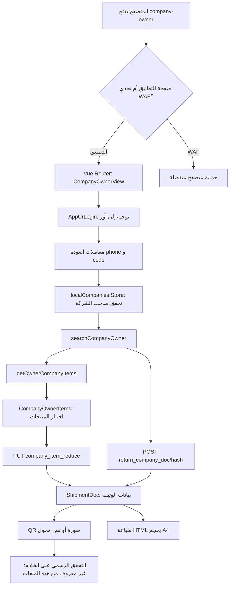

# UBOOR TECH — تقرير مراجعة مُدقّق ومقارنة الشيفرات

**تاريخ المراجعة:** 6 نوفمبر 2026  
**نوع العمل:** تحليل ثابت محلي للملفات المرفقة، دون تنفيذ API حي أو اختبارات تجاوز مصادقة.  
**النطاق:** صاحب الشركة، مواد الشركة، تقديم الشحنات، الوثائق المؤقتة وQR، بالإضافة إلى طبقة الطلبات العامة وحارس المسارات.  
**درجة اليقين:** مرتفعة في نصوص JavaScript الفعلية؛ غير محسومة في قواعد الخادم وقبول الطلبات والتحقق الرسمي من الوثائق.

## أ. الملفات التي تمت معاينتها

| المصدر | الحجم | بصمة SHA-256 / الدليل |
|---|---:|---|
| `index-gleMzSil.js` | 1,416,085 بايت | `83d3f35e2cf05cc56fca81a3531b98381d291dc1e903957be7b6e433466b7ac3` |
| `CompanyOwnerView-CIdFF3LL.js` داخل طلب HTTP المرفق | 22,978 حرف JavaScript مستخرج | الاستجابة المرفقة `HTTP 200 application/javascript`؛ تم فصل رأس الطلب عن الشيفرة |
| `ShipmentDoc-Dx885_fz.js` داخل طلب HTTP المرفق | 14,682 حرف JavaScript مستخرج | الاستجابة المرفقة `HTTP 200 application/javascript`؛ تم فصل رأس الطلب عن الشيفرة |
| `UBOOR_technical_analysis_2026-11-06.md` | 19,395 بايت | التقرير الأولي المُراجَع، وليس دليلًا مستقلًا أقوى من الكود |
| تسجيل طلبات HTTP / تحدي WAF | بيانات HTML وترويسات | يثبت اختلاف صفحة التحدي عن التطبيق، ولا يثبت مصادقة أي مستخدم |

**تحذير خصوصية:** لم تُنسخ أرقام هواتف أشخاص أو كوكيز WAF أو قيم Session/Authorization من التسجيلات إلى هذه الوثيقة. لا تُعدّ صفحة WAF مفتاحًا لتوقيع المستندات.

## ب. ملخص تصحيحات التقرير السابق

| البند | الصحيح بعد فحص الكود | النتيجة |
|---|---|---|
| تأكيد كود صاحب الشركة | `POST local_form/company_verification` مع `{code: value}` فقط | لا يرسل كود هذه الوظيفة الهاتف مرة ثانية في body |
| البحث عن الشركة | `POST local_form/search_iraqi_company` مع `page, per_page, searchdata, sort_by, sort_dir` | ليس `{code: hash}` المبسط الوارد في تقرير أقدم |
| جلب عناصر الشركة | `GET local_form/get_company_items/{companyOwner.hash_id}` | ليست بالضرورة قيمة `company_hash_code` |
| إرسال طلب شحن | `PUT local_form/company_item_reduce` | ليس `POST local_form/company_items` |
| إعادة وثيقة الشركة | `POST local_form/return_company_doc/{companyHash}` بجسم `null` | المعرّف في مسار URL، وليس حقل JSON |
| `return_doc_qrcode` | `POST` مع `doc_number:Number(value)` و`company_type` اختياري | لا دليل أنه يقرأ `{qr_code: scannedValue}` كما خمّن التقرير السابق |
| `return_doc_ceo` | `POST` مع `doc_number` و`company_type` اختياري | مع Bearer خاص بصاحب الشركة في الكود |
| تعريفات Router | **63** تعريفًا كما يظهر في الحزمة | تقرير أولي ذكر 62. يوجد مسار ابن فارغ وتكرارات على مستويات مختلفة |
| assets في manifest | **139** ملف JS/CSS | لا يعني أن محتوى كلها موجود في `index-gleMzSil.js` |
| `client_id=202` مقابل `261` | 261 لبوابة أصحاب الشركات؛ 202 ظهر في سياق خدمة قارئ أخرى | اختلاف الخدمة لا يدل وحده على تغيّر إصدار التطبيق |

## ج. المعمارية من البداية إلى النهاية



### المرحلة 1 — HTML وVite وVue Router

الصفحة الأساسية تحمل `index-gleMzSil.js` وملف CSS. داخل `index-gleMzSil.js` يوجد runtime لـVue، وPinia store، وVue Router، وعميل Axios، وفهرس تحميل ديناميكي لـ139 ملفًا. المسار `/company-owner` معرف بـ`requiresAuth:false` في طبقة Router، لأن واجهة صاحب الشركة تدير مصادقتها داخل المكوّن، **ولا يدل ذلك على أن API عام أو بلا صلاحيات**.

### المرحلة 2 — توجيه المستخدم إلى بوابة أور

داخل `AppUrLogin` تكوين عنوان `https://ur.gov.iq/verify-auth` مع `client_id=261`، و`redirect_uri=https://customs-uboor.ur.gov.iq/company-owner`، و`serviceName` و`pNo`. يوجد انتظار مصطنع 1500ms قبل تغيير `window.location.href`. هوية الخدمة في هذه المرحلة منفصلة عن QR والتوقيع. يجب عدم مساواة تحديات Huawei WAF بمصادقة حساب صاحب الشركة.

### المرحلة 3 — معاملات العودة واختبار الحالة

`CompanyOwnerView` يقرأ `phone` و`code` من `route.query`. يستدعي `checkUserAuthentication()` دون `await`، لكن **تنفيذ هذه الدالة نفسها لا يحتوي على `await`**؛ لذا فهي تُحدّث الحالة من LocalStorage تزامنيًا قبل أن تُرجع Promise. لذلك وصف ذلك وحده بأنه سباق في قراءة الجلسة سيكون غير دقيق. موضع الخطر الأدق هو `.finally()` الذي قد يُجري التوجيه بعد عملية أخرى، وأولوية فرع `phone` على `code` إن اجتمعا. ليس التصحيح المؤكد هو إرسال طلبَي الهاتف والرمز متتابعين؛ يلزم تعريف callback رسمي أولًا.

### المرحلة 4 — API التحقق من صاحب الشركة

`companyVerifyLogin(phone)` يرسل `POST local_form/company_verify_login` والجسم `{company_phone_number:phone}`. لا يثبت النص أن النظام أصدر OTP؛ رسالة الواجهة وحدها لا تثبت نجاح التسليم.  
`companyVerifyLoginWithCode(code)` يرسل `POST local_form/company_verification` والجسم `{code}` فقط. إذا كان HTTP 200، يقرأ `userinfo` و`access_token` و`ceo_company` ويخزن الثلاثة: `company_user_info_owner` و`company_owner_token` و`is_authenticated_owner` في LocalStorage.

### المرحلة 5 — استعادة الجلسة

`checkUserAuthentication()` تقرأ LocalStorage مباشرة؛ لا تتصل بالخادم. قد تكون راية الواجهة صحيحة محليًا بينما تنتهي صلاحية Bearer على الخادم. `JSON.parse` دون حماية كافية قد يكسر الاستعادة إذا تلفت البيانات. `logoutOwner()` يحذف بيانات الجلسة المحلية، **لكنه لا يصفر `companyOwner` أو `companyOwnerItems` أو `companyOwnerCeoLoads`**؛ في SPA مفتوحة قد تبقى بيانات الشركة في ذاكرة Pinia حتى استبدالها أو تحديث الصفحة. يلزم تنظيف الحالة الحساسة كاملًا أثناء الخروج.

### المرحلة 6 — البحث عن الشركة

`searchCompanyOwner(hash)` يرسل الهيكل التالي:

```json
{
  "page": 1,
  "per_page": 10,
  "searchdata": [{"company_hash_code": "EXAMPLE_COMPANY_CODE"}],
  "sort_by": "id",
  "sort_dir": "desc"
}
```

عند نجاح الطلب، يضع `response.data.data` في `companyOwner`. ثم **إذا توفر `companyOwner.hash_id`** يستدعي `getOwnerCompanyItems(companyOwner.hash_id)`؛ وليس بالضرورة النص الذي أدخله المستخدم. الاستدعاء غير منتظر بـ`await` في هذه الوظيفة. قد تعرض الواجهة بيانات الشركة أولًا والمواد لاحقًا، وينبغي معالجة حالة الانتظار والفشل وتصفير البيانات السابقة عند البحث الجديد.

### المرحلة 7 — المواد المرخصة

`getOwnerCompanyItems(hash_id)` يستخدم `GET local_form/get_company_items/{hash_id}` مع Bearer صاحب الشركة، ثم يخزن `response.data.items` في `companyOwnerItems`. الواجهة تعرض `hash_id`, `item_name`, `monthly_yearly`, `unit`, `production_capacity`, `is_active`، وتسمح بإدخال كمية مطلوبة لعدة مواد. لا يكفي تحقق المتصفح من الحدود أو الحالات؛ الخادم مسؤول عن تثبيت صحة الكمية وإذن صاحب الشركة في كل عملية.

### المرحلة 8 — إدخال السائق والمركبة والموقع

حقل `vihcle_info` في الشيفرة مكتوب بهذه الصورة، ويلزمه تطابق عقد الخادم قبل تغييره. يحتوي مفاتيح منها: `driver_name`, `licence_number`, `checkpoint_name_control`, `company_name`, `vehicle_number`, `registration_governorate`, `cargo_typedetails`, `weight_quantity`, `destination_governorate`, `x_coordinate`, `y_coordinate`.  
الواجهة تعرض سيطرات من قائمة ثابتة وتطلب اختيارها لبعض أنواع الشركات. تراقب الموقع الجغرافي وتضع `latitude` في `x_coordinate` و`longitude` في `y_coordinate`، رغم أن التسميات بالعربية تشير إلى معنى X/Y المعاكس. هذا تعارض مثبت يجب حله بتوثيق من API قبل تعديل البيانات. كما يُسجل الموقع في console؛ الأفضل إزالته.

### المرحلة 9 — بناء الطلب وإرساله

تجهز الواجهة عناصر بالشكل `item1`, `item2`... مع `hash_id` و`production_capacity` الذي يمثل هنا كمية الطلب المختارة في الواجهة. ثم تضيف `vihcle_info`، وتستدعي `companyItemsReduce(payload)`.  
**الطلب الصحيح:** `PUT local_form/company_item_reduce` مع Bearer صاحب الشركة.  
**اختلاف مهم في النتيجة:** الوظيفة تستخرج `response.data.data ?? response.data` وتضعه في `companyOwner`، لكنها **تُرجع `response.data`** إلى المكوّن. إذا كان الرد مغلفًا داخل `data`، قد يحصل `ShipmentDoc` على شكل غير مباشر، وقد تصبح `companyOwner` بيانات مستند بدل شركة. الأثر الدقيق مشروط بشكل استجابة الخادم.

### المرحلة 10 — عرض وثيقة شحنة جديدة

`CompanyOwnerItems` يضع نتيجة `companyItemsReduce` في مرجع ويفتح Modal بعنوان «الوثيقة المؤقتة»، ويمرر النتيجة إلى `ShipmentDoc` عبر خاصية `doc`. الكود لا يتحقق قبل الفتح من وجود `doc_id` في هذا المسار، بخلاف مسار إعادة إصدار وثيقة الشركة.

### المرحلة 11 — إعادة توليد وثيقة الشركة

المسار المستقل `returnCompanyDoc(companyHash)` يرسل `POST local_form/return_company_doc/{hash}` وجسمًا `null`، مع Bearer صاحب الشركة. ويتوقع `response.data.data.doc_id`؛ إن لم يجده، يعيد `null` مع رسالة نقص البيانات. تستعمل واجهة البحث قيمة `company_hash_code` من بيانات الشركة إن توفرت، وإلا قيمة حقل البحث. وزر إعادة التوليد يعتمد جزئيًا على وجود النص في الحقل رغم إمكان توفر رمز الشركة في الحالة، ما قد يمنعه في بعض السيناريوهات.

### المرحلة 12 — استرجاع برقم الوثيقة وسجل الحمولات

`regenerateDocument(docNumber,companyType)` تستدعي `POST local_form/return_doc_qrcode` بجسم `doc_number:Number(docNumber)`، وتضيف النوع اختياريا. **`id:Date.now()` في النتيجة محلي للاستخدام في الواجهة، وليس رقم الوثيقة الرسمي.**  
`fetchCompanyCeoLoads()` تستدعي `POST local_form/paginate_company_ceo` مع بيانات pagination والتاريخ، و`returnDocCeo(docNumber,companyType)` تستدعي `POST local_form/return_doc_ceo` مع Bearer صاحب الشركة. هذه الوظائف منفصلة عن توليد توقيع QR الرسمي.

### المرحلة 13 — ShipmentDoc وQR

`ShipmentDoc` يعرض بيانات `doc_id`, `date_str`, `time_str`, `subject`, `items`, `driver_name`, `vehicle_number`, `company_name_project`, `license_approval_number` وغيرها. يقرأ `doc?.qr_code || doc?.response?.qr_code`، ثم يتعامل مع أربع حالات:

| الحالة | السلوك الظاهر | الملاحظة |
|---|---|---|
| `data:image...` | يعرض Data URL مباشرة | وجود الصورة لا يثبت صحة الوثيقة |
| رابط يبدأ بـ`https://customs-uboor.ur.gov.iq/robot?url=` | يأخذ الجزء النصي بعد `url=` ثم يستخدم مكتبة QR لتحويله لصورة | محتوى الرمز قد يكون نص المعامل، وليس الرابط الكامل |
| Base64 طويل أحرفه محدودة | يفترض أنه صورة PNG جاهزة | تصنيف غير موثوق للنوع وقد يسبب صورة معطوبة |
| `qr_code` غير موجود | يحوّل رقم الرخصة أو المركبة أو اسم السائق إلى QR | **ليس رمز تحقق رسميًا** ويجب وسمه بوضوح أو منعه |

توليد QR في المتصفح يتم عن طريق `Q.toDataURL(value,{width:200,margin:1})`. ولا يظهر هنا مفتاح توقيع خاص أو إثبات تسجيل الوثيقة رسميًا في الخادم.

### المرحلة 14 — الطباعة والحفظ PDF

الطباعة تستخدم `window.open` و`document.write` و`window.print` لصفحة HTML من مكون المستند، مع CSS يحتوي `@page { size:A4; margin:0; }` وعرض `210mm` وارتفاع `296mm` و`overflow:hidden`. هذا ينتج مستندًا قابلاً للطباعة/الحفظ كـPDF، لكنه **ليس دليلاً على توقيع PDF من خادم رسمي**. الارتفاع والقص قد يخفيان بعض المواد في الوثائق الطويلة.

### المرحلة 15 — التحقق بعد مسح QR

لا يمكن من هذه الملفات تحديد ماذا يفعل قارئ QR النهائي أو كيف يثبت الخادم أصالة الوثيقة. فهرس Vite يشير إلى وحدات `qrStore-B8bgApfd.js`, `QRDocument-BJwpoEJY.js`, `QRLocal-5TAaXbzM.js`, `QrCodeReaderCustoms-a-UBVR7y.js` وغيرها؛ لكن محتوياتها غير متاحة كاملة ضمن الملف الرئيسي المرفق. يلزم هذه الوحدات ثم توثيق API أو استجابة مصرح بها، ولا يجوز تعويضها بالاستنتاج من الأسماء.

## د. جدول طلبات API المثبتة في حزمة main

**baseURL:** `https://customs-uboor.ur.gov.iq/api/`

| Method | API نسبي | Body/ملاحظة | مستوى الثبوت |
|---|---|---|---|
| POST | `local_form/company_verify_login` | `company_phone_number` | مثبت بالشفرة |
| POST | `local_form/company_verification` | `code` فقط | مثبت بالشفرة |
| POST | `local_form/search_iraqi_company` | page/per_page/searchdata/sort | مثبت بالشفرة |
| GET | `local_form/get_company_items/{hash_id}` | مسار معرف الشركة | مثبت بالشفرة |
| PUT | `local_form/company_item_reduce` | عناصر + `vihcle_info` | مثبت بالشفرة |
| POST | `local_form/return_company_doc/{hash}` | `null` | مثبت بالشفرة |
| POST | `local_form/return_doc_qrcode` | `doc_number`, `company_type` اختياري | مثبت بالشفرة |
| POST | `local_form/paginate_company_ceo` | pagination/date filters | مثبت بالشفرة |
| POST | `local_form/return_doc_ceo` | `doc_number`, `company_type` اختياري | مثبت بالشفرة |
| POST | `local_form/send_company_code/{id}` | كائن JSON فارغ | مثبت بالشفرة |

**ملاحظة مصادقة:** استدعاءات صاحب الشركة المعرّفة فوق لا تتبع كلها القاعدة نفسها؛ بعضها يضيف Bearer صاحب الشركة صراحة، بينما `regenerateDocument` لا يضيفه صراحة في الدالة. ومع ذلك يوجد Request interceptor عالمي قد يضيف توكن المستخدم الإداري. لا يعني غياب رأس صريح من دالة ما أن الخادم يقبلها بلا مصادقة.

## هـ. تدقيق الأمن والأخطاء — بأولوية هندسية

| الأولوية | الرمز | الدليل | الخطر/التفسير | معالجة دفاعية |
|---|---|---|---|---|
| عالية | A-01 | request interceptor يعيد كتابة `Authorization` إذا وجد `UserAuth.token` | تصادم بين توكن الموظف وصاحب الشركة | عميل Axios مستقل لكل سياق أو سياسة صريحة للرؤوس |
| عالية | A-02 | 401 في interceptor يستدعي logout إداري وlogoutOwner | إخراج المستخدم من السياقين بسبب طلب واحد | اختيار الاستجابة وفق سياق الطلب |
| عالية | A-03 | `checkUserAuthentication` محلي فقط | الواجهة قد تبقى في حالة مصادقة رغم رفض الخادم | التحقق من الصلاحية وانتهاء الرمز على الخادم |
| عالية | A-04 | `CompanyOwnerView` يفضل phone على code، وتوجد توجيهات `.finally` متنافسة | خلل محتمل في callback/التنقل؛ مع ملاحظة أن استعادة LocalStorage نفسها تزامنية | ترتيب callback واضح وتعريف حالات العودة |
| متوسطة | D-01 | `companyItemsReduce` تخزن كائنًا مختلفًا عن الذي تُرجعه | شكل مستند غير متسق/إفساد حالة الشركة | DTO موحد وفصل company عن document |
| متوسطة | D-02 | `logoutOwner` لا يصفر company/items/loads | بيانات شركة قد تبقى في الذاكرة بعد الخروج | مسح جميع بيانات السياق عند logout |
| متوسطة | D-03 | عدم انتظار `getOwnerCompanyItems` | ظهور بيانات الشركة قبل المواد أو خطأ جزئي | await أو حالة منفصلة للتحميل والفشل |
| متوسطة | D-04 | X/Y يخالفان التسميات في UI | احتمال خطأ موقع على الخادم | توثيق schema وأسماء `latitude` / `longitude` الصريحة |
| متوسطة | D-05 | watch immediate يلمس `o` قبل تعريفه | خطأ تهيئة مشروط بوصول إحداثيات فورية | تعريف الحالة قبل تسجيل watch |
| متوسطة | D-06 | fallback QR من حقول الشخص/السيارة | الالتباس بين QR معلوماتي ورمز تحقق | عرض «QR غير متوفر» بدل بديل تلقائي |
| متوسطة | D-07 | Base64 regex دون تحقق من النوع | احتمال عرض صورة غير صحيحة | فحص MIME/ترويسة الصورة |
| متوسطة | D-08 | ملف الطباعة يستخدم overflow hidden | قص مستندات طويلة | طباعة متعددة الصفحات/اختبار الحالات |
| متوسطة | D-09 | حساب `weight_quantity` بجمع `production_capacity` لمنتجات ربما مختلفة الوحدات | إجمالي غير متجانس | فرض وحدة متجانسة أو فصل الإجماليات |
| منخفضة | D-10 | console logging للموقع ورمز الشركة | تعرض بيانات تشغيلية في سجلات المتصفح | إزالة السجلات الحساسة |

**لا تثبت الملاحظات أعلاه إمكان تزوير مستند رسمي أو تجاوز مصادقة الخادم؛ هي أخطاء منطقية ومخاطر دفاعية محتملة.**

## و. تصحيح الدقة في تقارير سابقة

1. وصف حصول OTP مرسل من `company_verify_login` كان فرضية؛ الدالة تعرض رسالة ترحيب، ولا يظهر تنفيذ إرسال الرسالة في الواجهة.
2. لم يظهر في `company_verification` إرسال `company_phone_number` مع `code`؛ الشيفرة ترسل `code` فقط.
3. لا يوجد دليل من الحزمة على أن `company_hash_code` خوارزمية SHA-1 أو أنه مفتاح توقيع مستند.
4. لا ينبغي الجزم بأن `return_doc_qrcode` مصمم لمسح QR مباشرة؛ من الشيفرة المتاحة تستدعيه وظيفة إعادة استرجاع/توليد بالرقم `doc_number`.
5. `client_id=202` ظهر في سياق خدمة أخرى؛ لا يمثل بالضرورة إصدارًا سابقًا من `client_id=261`.
6. استجابة `HTTP 200` من WAF قد تحتوي HTML تحديًا؛ يجب التفريق بين نوع المحتوى وحالة نجاح API. لم تُنفّذ هذه المراجعة تحديات WAF.
7. `id:Date.now()` في الكائن المصنوع لـ`regenerateDocument` ليس `doc_id` رسميًا.
8. وجود رؤوس أمان CSP/HSTS جيد، لكن `unsafe-inline` و`unsafe-eval` يقللان صرامة CSP؛ لا يثبت ذلك بمفرده ثغرة XSS.
9. **عدد تعريفات المسارات في main وفق استخراج regex لهذه الحزمة 63**، وليس 62 كما جاء في التقرير الأولي. بعض التعريفات متداخلة أو مكررة نسبيًا.

## ز. ما لم يُثبت ويحتاج أدلة أخرى

- خوارزمية إصدار المستند أو مصدر `doc_id` الحقيقي أو قواعد ترقيمه.
- الصيغة الرسمية للتحقق من `qr_code` أو صحة توقيعه أو حالة إلغاء الوثيقة.
- هل رد `company_item_reduce` مغلف في `data` دائمًا، وهل يحمل `doc_id` كاملًا؟
- صلاحيات العمليات داخل Backend، وحدود المعدلات وتحقق ملكية الشركة وكميات المواد.
- محتوى وحدات قارئ QR الديناميكية غير المرفقة.
- شكل API النهائي إن حصل تغيير منذ النسخة المحفوظة.

## ح. خطة اختبار آمنة ومحددة

1. **اختبارات وحدات دون اتصال:** اختبار DTO نتيجة الشحنة في الحالتين `{data:doc}` و`doc`؛ اختبار غياب QR وسلاسل Base64 والحالات الفارغة؛ اختبار خلط الوحدات، ترتيب callback، والخروج الكامل من Store.
2. **فحص مصدر الشيفرات غير الموجودة:** إضافة `CompanyOwnerCeoLoadsView-Coghn9Xh.js` ووحدات القارئ `qrStore` و`QRDocument` و`QrCodeReaderCustoms`.
3. **تسجيل أداء مشروع مخول:** مشارَكة HAR منقح يزيل `Cookie`, `Set-Cookie`, `Authorization`, `access_token`, رقم الهاتف، معلومات السائق والوثائق الحساسة، مع الحفاظ على أسماء الحقول وحالات HTTP. لا تستخدم كوكيز WAF يدويًا ولا تعيد تنفيذ طلبات إصدار حقيقية للتجربة.
4. **مراجعة Backend بتخويل صريح:** وثائق Swagger/DTO، قيود صلاحيات الشركة، معاملات idempotency، وتحقق التوقيع والحالة.

## ط. فهرس الأدلة داخل `index-gleMzSil.js`

**تنبيه:** كثير من الوظائف في **السطر الفيزيائي 25** من الملف المضغوط؛ الإزاحات التالية هي مواقع أحرف تبدأ من الصفر داخل النص بعد قراءته UTF-8، لتسهيل البحث في المصدر الخام.

| عبارة البحث | الإزاحة (أحرف) | السطر |
|---|---:|---:|
| `yq=qm("localCompanies"` | `587,787` | `25` |
| `async companyVerifyLogin(` | `595,232` | `25` |
| `async companyVerifyLoginWithCode(` | `595,528` | `25` |
| `async searchCompanyOwner(` | `596,247` | `25` |
| `async getOwnerCompanyItems(` | `596,902` | `25` |
| `async companyItemsReduce(` | `597,269` | `25` |
| `async checkUserAuthentication(` | `597,880` | `25` |
| `async returnCompanyDoc(` | `598,236` | `25` |
| `logoutOwner(){` | `599,809` | `25` |
| `async regenerateDocument(` | `600,081` | `25` |
| `async fetchCompanyCeoLoads(` | `600,573` | `25` |
| `async returnDocCeo(` | `601,389` | `25` |
| `tt=pn.create(` | `601,920` | `25` |
| `tt.interceptors.request.use(` | `601,994` | `25` |
| `tt.interceptors.response.use(` | `602,197` | `25` |
| `Dq=[` | `612,957` | `25` |
| `Qr.beforeEach(` | `625,058` | `25` |
| `nu=qm("UserAuth"` | `625,496` | `25` |

## ي. ملحق Router — تعريفات المسارات الـ63

| # | path | name |
|---:|---|---|
| 1 | `/` | `Home` |
| 2 | `/user-auth` | `LoginView` |
| 3 | `/change-password` | `ChangePasswordView` |
| 4 | `/company-owner` | `CompanyOwner` |
| 5 | `/company-owner/ceo-loads` | `CompanyOwnerCeoLoads` |
| 6 | `/inspectionReport` | `inspectionReport` |
| 7 | `/achievementDocument` | `achievementDocument` |
| 8 | `/dashboard` | `Dashboard` |
| 9 | `(مسار ابن فارغ)` | `DashboardHome` |
| 10 | `requests` | `Requests` |
| 11 | `requests/:id` | `RequestById` |
| 12 | `local-companies` | `LocalCompanies` |
| 13 | `External-loads` | `ExternalLoads` |
| 14 | `external-loads/:id/info` | `localCompanyInfo` |
| 15 | `local-companies/:id/info` | `infoLocalCompany` |
| 16 | `new-companies` | `addLocalCompany` |
| 17 | `local-companies/:id/edit` | `editLocalCompany` |
| 18 | `qr/local-rejected` | `RejectedLocalDocuments` |
| 19 | `local-companies-items/:id` | `localCompanyItems` |
| 20 | `items` | `companyItems` |
| 21 | `add-item` | `addItemsToCompany` |
| 22 | `edit-item/:item_id` | `editCompanyItems` |
| 23 | `qr` | `QRMenu` |
| 24 | `clearance-agents` | `ClearanceAgent` |
| 25 | `government_agencies` | `GovernmentAgencies` |
| 26 | `entrance-gate` | `EntranceGate` |
| 27 | `sonar` | `Sonar` |
| 28 | `radiation` | `Radiation` |
| 29 | `customes-offices` | `CustomesOffices` |
| 30 | `support-orgs` | `SupportOrgs` |
| 31 | `inspection` | `Inspection` |
| 32 | `audity-station` | `AudityStation` |
| 33 | `box-station` | `BoxStation` |
| 34 | `guessing-station` | `GuessingStation` |
| 35 | `completion-station` | `CompletionStation` |
| 36 | `manager` | `Manager` |
| 37 | `exit-gate` | `ExitGate` |
| 38 | `health-certificates` | `HealthCertificates` |
| 39 | `health-certificates/new` | `addHealthCertificate` |
| 40 | `health-certificates/disable` | `DisableHealthCertificate` |
| 41 | `health-certificates/print` | `HealthCertificatePrint` |
| 42 | `health-certificates/:id` | `HealthCertificateDetail` |
| 43 | `health-certificates` | `HealthCertificates` |
| 44 | `users` | `UsersManagement` |
| 45 | `roles` | `RolesManagement` |
| 46 | `privileges` | `PrivilegesManagement` |
| 47 | `orgs` | `OrgsManagement` |
| 48 | `national-security-routes` | `NationalSecurityRoutes` |
| 49 | `logs` | `LogEvents` |
| 50 | `qr` | `QRMenu` |
| 51 | `qr/local` | `QRLocal` |
| 52 | `qr/imported` | `QRImported` |
| 53 | `qr/health` | `QRHealthCertificate` |
| 54 | `qr/certificate-readers` | `QRCodeReaders` |
| 55 | `qr/customs-readers` | `QRCodeReadersCustoms` |
| 56 | `qr/readings` | `QRReadings` |
| 57 | `qr/qr-importer` | `QRLocalImporter` |
| 58 | `qr/control-scans` | `ControlScans` |
| 59 | `qr/document` | `QRDocument` |
| 60 | `qr/achievement-document` | `AchievementDocument` |
| 61 | `qr/disable-document` | `DisableDocument` |
| 62 | `/qr/checkpoints` | `QRCheckpoints` |
| 63 | `announcements` | `Announcements` |

---

**الحكم الختامي:** أصبح لدينا توصيف موثوق للواجهة الأمامية والتدفق حتى تجهيز الوثيقة وعرض QR. أي ادعاء بمعرفة «كاملة ومطلقة» للخادم أو التوقيع الرسمي أو خوارزمية اعتماد الرمز سيبقى غير مدعوم دون وثائق الخادم أو استجابات مصرح بها. يمكن تحسين دقة التحليل أكثر بمراجعة الوحدات الديناميكية الخاصة بالمسح والوثائق، لا بإعادة استخدام جلسات المستخدم أو تجاوز طبقة الحماية.
